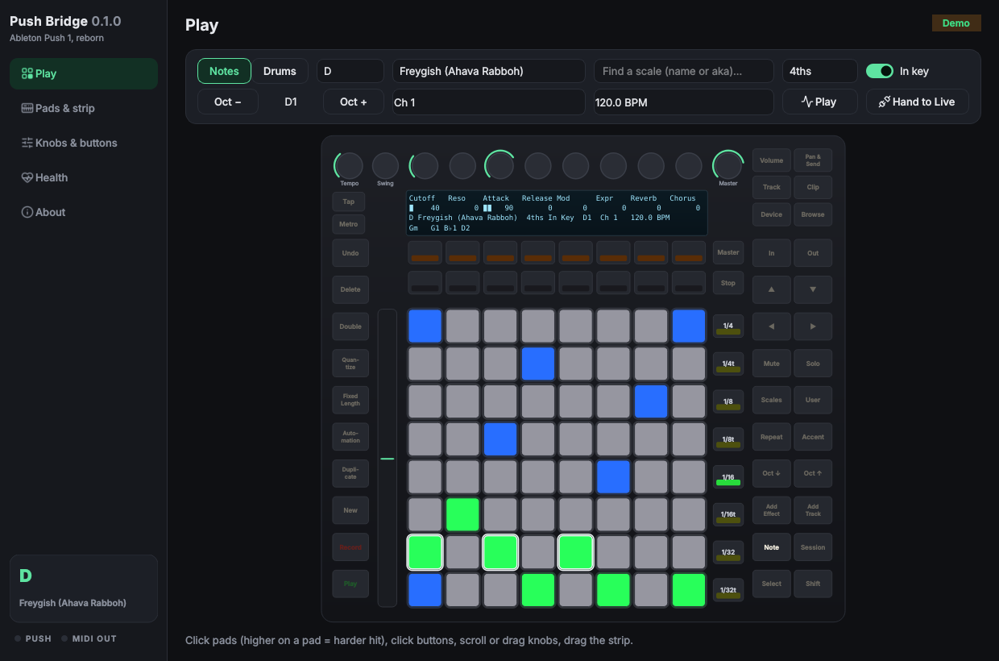

# Push Bridge

Play the **original (2013) Ableton Push** with any MIDI software on Linux: Bitwig, Reaper, Ardour, Surge XT, Vital, Noodle, a hardware synth on a USB-MIDI cable, or anything else that takes MIDI.

The Push 1 is a class-compliant USB-MIDI device, so Linux sees it out of the box. On its own, though, it's a dumb grid. Scales, in-key layouts, the display and the colours all came from Ableton Live's script. Push Bridge does that job instead:

- **Notes mode** with Live-style **in-key** or **chromatic** layouts (4ths, 3rds or sequential), with root pads in blue and in-scale pads in white. When you press a note, every pad with that pitch lights up.
- **67 scales**, the same list as Noodle. Klezmer names sit beside the textbook ones (Freygish / Ahava Rabboh, Mi Sheberach, Adonai Malach, Magen Avot), along with Irish/Scottish modes, jazz, harmonic-minor modes, maqam and Balkan approximations, Japanese, Indian thaat and more. Notes are spelled properly for the key (D Freygish is D E♭ F♯ G A B♭ C).
- **Scales page on the Push itself.** Press **Scales**: the top button row picks C G D A E B and the row above the pads picks F B♭ E♭ A♭ D♭ G♭, as on Live. Any knob scrolls through scales. The last two top buttons switch the layout and In Key / Chromatic.
- **Drums mode** (press **Note**): four colour-coded 4×4 blocks starting at C1 (36), so GM kits land where you'd expect. Octave buttons move by 16.
- **Live chord names** on the Push's LCD while you play (Gm, Cmaj7, D7/F♯ …).
- **Pressure**: polyphonic or channel aftertouch. The **touch strip** does pitch bend or mod wheel.
- **Accent** (full velocity), **velocity curves** (soft / hard / fixed).
- **Note Repeat** with the 1/4–1/32t buttons. Press harder to play the repeats louder.
- **8 knobs + Master** send CCs. Name them in the app and the LCD shows the names and values. Shift+turn gives fine control, and there's an optional relative mode for endless-encoder-aware software.
- **MIDI clock**: Play starts and stops it, the Tempo knob sets BPM (Swing knob = 0.1 BPM fine), Tap Tempo taps and blinks on the beat.
- **Every other button is yours.** It sends a CC you can MIDI-learn. Send the CC back and the button's light follows.
- **Notes coming back from your software light the pads** in orange, so a MIDI file playing in your DAW shows on the grid.
- **User button = plain MIDI controller.** The raw Push goes straight to your software and back, including LEDs and LCD sysex.
- **Hand off to Ableton Live.** When another app (for example Live under Wine) starts driving the Push directly, Push Bridge goes quiet and takes over again once that app lets go. There's also a manual switch.
- **Live on-screen Push** that mirrors every light and the display. It also works as a virtual Push you can play with the mouse.
- **Health check** for every link from the Push to your software, including which apps are listening and whether anything else is fighting over the Push.
- **Stays out of the way**: tray icon, start at login, headless systemd service.

Licensed GPL-3.0-or-later. © 2026 Fancy Butler. Not affiliated with Ableton or Akai.



---

## Install

```fish
git clone https://github.com/fancy-butler/pushbridge
cd pushbridge
```

Plug the Push in **with its power supply** (USB bus power alone can't light it fully), then check that Linux sees it:

```fish
aconnect -l | grep -i push      # → client NN: 'Ableton Push' with two ports
```

### Arch / CachyOS

```fish
cd packaging/arch
makepkg -si
```

### Fedora

```fish
sudo dnf install python3-pyside6 alsa-lib pipx
pipx install --system-site-packages .
```

### Debian / Ubuntu (24.04+)

```bash
sudo apt install python3-pyside6.qtwidgets python3-pyside6.qtsvg pipx
pipx install --system-site-packages .
```

There are no compiled extensions and no udev rule to install. MIDI goes straight to `libasound` through ctypes, using the ALSA *sequencer*. That means Push Bridge never locks the Push away from other software.

Run `pushbridge`, or `pushbridge --demo` to try it without hardware.

## Use it

1. Start Push Bridge. The Push lights up and its display shows your scale.
2. In your software, pick **Push Bridge › Push 1** as the MIDI input (under PipeWire it may just say "Push Bridge").
3. Play.

| On the Push | Does |
|---|---|
| **Scales** | Key and scale page (top row C G D A E B, lower row F B♭ E♭ A♭ D♭ G♭, any knob = scale) |
| **Note** | Notes ↔ Drums |
| **Octave ↑↓**, **▲▼** | Octave (drums: ±16 pads) |
| **◀ ▶** | Root down/up a semitone (Shift: a 5th) |
| **Accent** | Every hit at 127 |
| **Repeat** + 1/4 … 1/32t | Note repeat at that rate |
| **Play**, **Tap Tempo**, Tempo/Swing knobs | MIDI clock |
| **User** | Plain MIDI controller (raw pass-through) |
| **Shift** + knob | Fine adjust |
| Everything else | A CC on channel 16 (configurable) for MIDI-learn, with light feedback |

## Ableton Live on Linux

Live doesn't run natively on Linux. People run it under Wine with mixed results, and whether Live's Push 1 script works through Wine's MIDI is up to Wine. Push Bridge just makes sure it doesn't get in the way: when Live (or any other app) connects to the Push directly, Push Bridge steps aside automatically (Knobs & buttons › App), and the **Hand to Live** button does it by hand.

## Headless

```fish
systemctl --user enable --now pushbridge.service
```

## Credits

Ableton never published the Push 1 protocol. Push Bridge builds on community work: [crosslandwa/push-wrapper](https://github.com/crosslandwa/push-wrapper), [Carlborg/hardpush](https://github.com/Carlborg/hardpush), the pushmod blog (RGB pad sysex) and Adam Murray's palette notes. Icons: Lucide (ISC).
